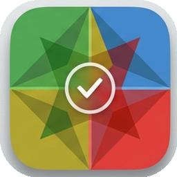
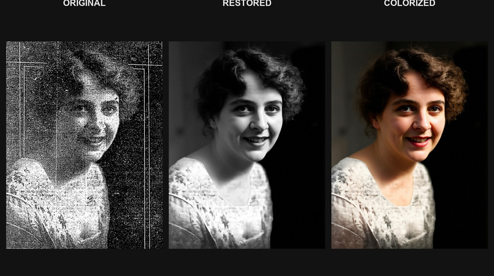
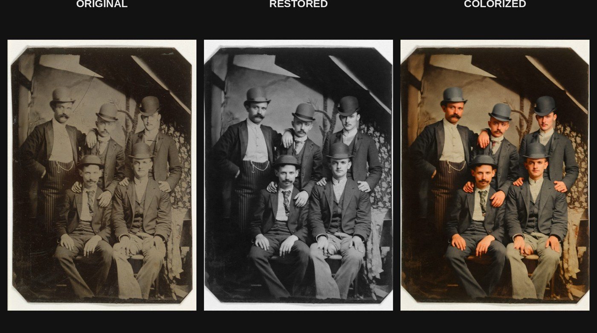

**Need data or an app? I build it for you.**

---

## 🛠️ What I can build for you

| You need | I deliver | See my work |
|---|---|---|
| **A scraper or a data feed** | A custom [Apify](https://apify.com/0xgollum) actor that collects, cleans and delivers the data you need, on a schedule, and alerts you when something changes | [32 live actors →](https://github.com/0xGollum/Apify) |
| **A mobile app** | A clean Android and iPhone app, from idea to the store | [X Light, Ike →](#-mobile-apps) |
| **Old photos restored** | Scratches and damage repaired, optional colorization | [Before / after →](#️-photo-restoration) |

**▶ [Tell me what you need on Fiverr](https://www.fiverr.com/crabe666)** · or open an issue on any repo.

## 📡 Proof of work · Signal feeds on Apify

Not raw scrapes: tools that watch a source non-stop and tell you *what just changed that's worth acting on* — a price shortening before a race, unusual option volume landing today, a company that just filed to raise money. Small structured datasets, built to run on a schedule.

| | |
|---|---|
| 📈 **Betting & trading signals** | Unusual options flow, horse-racing odds movers, funding-rate arbitrage, prediction-market gaps |
| 🎯 **B2B intent & lead generation** | Funding, hiring and buying signals, review-crisis radar, contact verification |
| 🤖 **AI-ready** | Signal Hub MCP: give your agent every signal, no dashboard |

**▶ Browse all 32 actors → [github.com/0xGollum/Apify](https://github.com/0xGollum/Apify)** · [apify.com/0xgollum](https://apify.com/0xgollum)

---

## ⚙️ n8n workflow templates

Five published, tested end to end, ready to import. Each one runs on free tiers and posts to Telegram.

| Template | What it does |
|---|---|
| [Crypto funding-rate alerts](https://n8n.io/workflows/19910) | CoinGecko funding rates → Telegram |
| [Grouped GitHub release alerts](https://n8n.io/workflows/20303) | New releases, grouped, with an optional AI summary |
| [SSL certificate expiry alerts](https://n8n.io/workflows/20933) | Know before a certificate expires |
| [Daily crypto fear & greed report](https://n8n.io/workflows/21113) | One clean market-mood message every day |
| [Horse-racing odds movement alerts](https://n8n.io/workflows/22126) | Odds movers with Apify, straight to Telegram |

---

## 🧩 Side projects

When I'm not building signals, I ship small things I'd want to use myself.

### 📱 Mobile apps

| | App | Android | iPhone |
|---|---|---|---|
|  | **X Light** The one-tap flashlight: 500+ themes, widget, background torch, 11 languages. Free, no account. | [**Google Play**](https://play.google.com/store/apps/details?id=com.oxgollum.xlight) | [TestFlight beta](https://testflight.apple.com/join/Mj9y8zvb) |
|  | **Ike** The Eisenhower matrix in your pocket: sort tasks by urgency and importance, tick, archive, back up, 11 languages. | [**Google Play**](https://play.google.com/store/apps/details?id=com.oxgollum.ike) | [TestFlight beta](https://testflight.apple.com/join/NYXZnDFW) |
|  | **Bottle Buddies** A cute water-sort puzzle where the bottles have faces. | Coming soon | [TestFlight beta](https://testflight.apple.com/join/vDM61tsM) |

*iPhone versions are in public beta through TestFlight (10 spots per app): your feedback shapes the final release.* [Android screenshots and details →](https://github.com/0xGollum/Android)

---

### 📻 The Last Signal — 24/7 dark synth radio

A live radio channel that never sleeps: original music made with AI tools, rainy cyberpunk visuals, distant thunder. Turn the radio on, the signal is still here.

[**▶ Tune in on YouTube →**](https://www.youtube.com/@lastsignal-radio)

---

### 🖼️ Photo restoration

Old, damaged family photos brought back to life: scratches, stains and noise repaired, then (optionally) colorized with natural tones. Original → restored → colorized:

**[▶ Order a restoration on Fiverr →](https://www.fiverr.com/crabe666)**

---

📬 Questions or custom work? Open an issue on any repo or find me on [X](https://x.com/Gollum0x58577).

